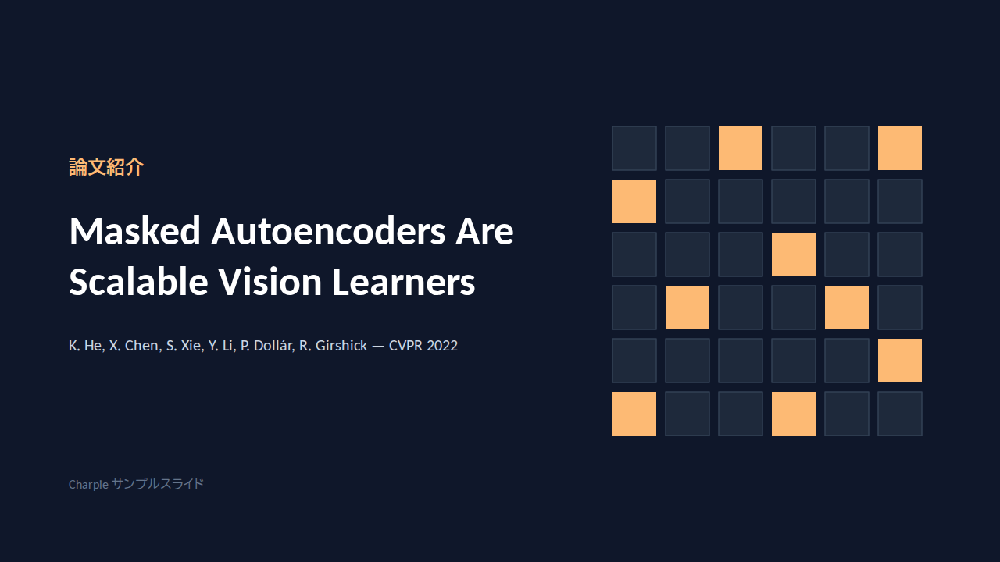
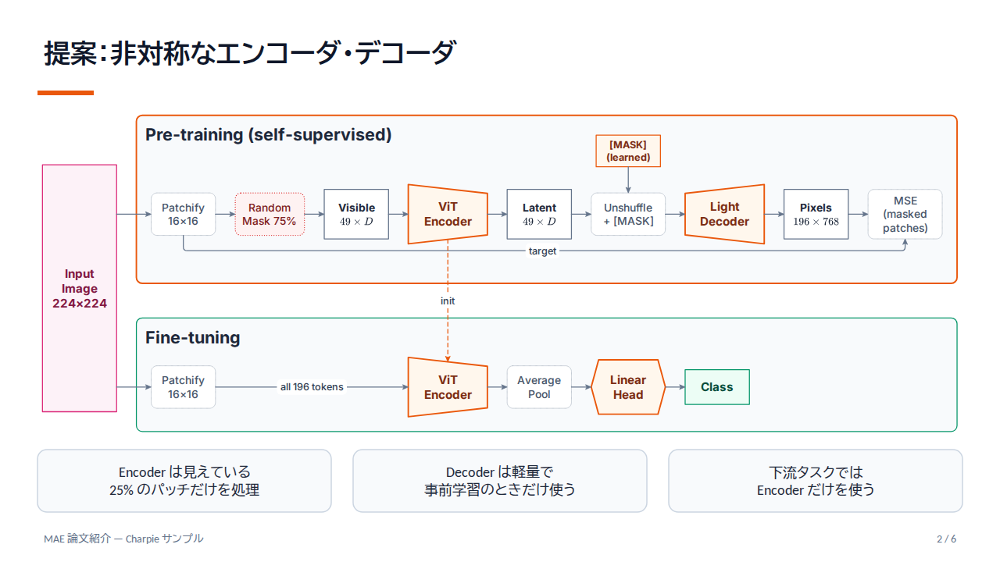
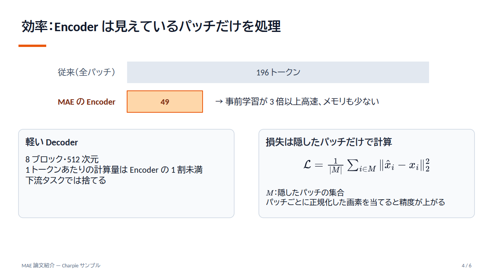
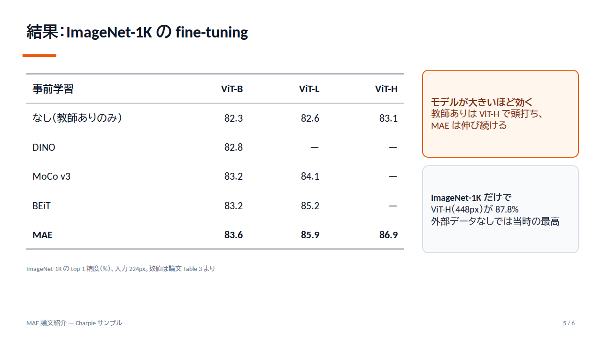
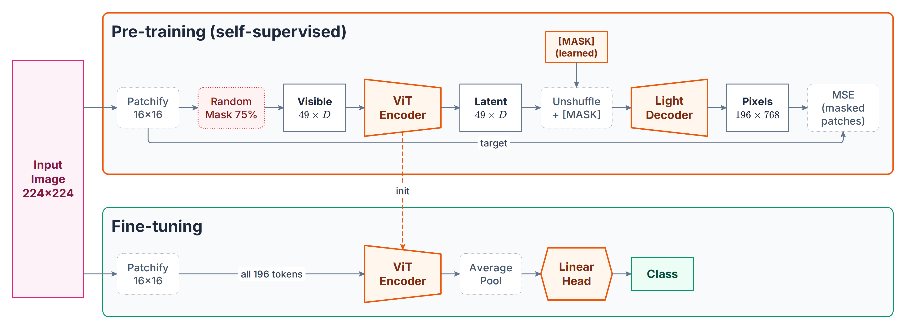

# Charpie

**テキストが正本**の、概念図とスライドのエディタ。
キャンバスでドラッグしても、テキストを書き換えても、AI エージェントが API を叩いても、同じ 1 つの `.charpie` ファイルが更新されます。

- **図もスライドも同じ記法で** — `page` / `layout` を書けばスライドになり、ロゴ・帯・ページ番号のような共通部分は 1 回だけ書けば済みます
- **崩れたらすぐ分かる** — 重なり・文字のはみ出し・矢印の貫通・ページからのはみ出しを常に検査し、`fix` で自動的に直せます
- **そのまま使える形で書き出せる** — PDF / PowerPoint（図形・表・箇条書きのまま編集できる）/ TikZ（LaTeX 文書）/ SVG / PNG
- **AI エージェントと一緒に作れる** — ブラウザ・ディスク上のファイル・HTTP API が常に同期するので、Claude Code に書かせた図をその場で見て直せます

## デモ

### スライド

見本の [diagrams/mae_talk.charpie](diagrams/mae_talk.charpie)（MAE の論文紹介、7 枚）。2 枚目は下の図をそのまま埋め込んでいます。

| | |
|---|---|
|  |  |
|  |  |

<details>
<summary>このスライドの書き方（抜粋）</summary>

```
set canvas=1280x720 gap=12 family=Calibri compat=pptx

layout default {                               # 全ページ共通
  slot  title  "タイトル"           at (48, 32) size 1184x72 .title
  rect  rule                        at (48, 116) size 72x6 .rule
  text  pageno "{page} / {pages}"   at (1092, 672) size 140x36 .muted halign=right
}

page result "結果" {
  title "結果：ImageNet-1K の fine-tuning"
  table acc at (48, 150) size 820x390 align=l,r,r,r {
    | 事前学習 | ViT-B    | ViT-L    | ViT-H    |
    |---------|---------:|---------:|---------:|
    | BEiT    | 83.2     | 85.2     | —        |
    | **MAE** | **83.6** | **85.9** | **86.9** |
  }
  round big "**モデルが大きいほど効く**\n…" at (900, 150) size 332x186 .card
}
```

</details>

### 図

見本の [diagrams/mae_example.charpie](diagrams/mae_example.charpie)（MAE の概要図）。



### UI


## はじめかた

```bash
npm install
npm run build
npm run serve    # diagrams/ の *.charpie を同期しながら http://localhost:5173 で起動
# 任意のディレクトリ: node dist-server/cli.js serve path/to/dir
```

あとは Claude Code に頼むだけです。

```
models/ のモデルを、diagrams/mae_example.charpie を参考に概念図にして
この論文の紹介スライドを、diagrams/mae_talk.charpie を参考に 6 枚くらいで作って
```

`diagrams/` は各自の作業場で、見本の `mae_example.charpie` / `mae_talk.charpie` / `deck_demo.charpie` 以外は git 管理しません（`.gitignore` 済み）。

## 人間が書いた説明
- AI エージェントで概念図を書くためのツールです。
    - 主にスライドに載せる用途で使えます。
    - 論文に載せるなどの用途は一応非推奨です。
- **How to use**
    - clone して、`xx/のディレクトリのモデルを、 sample図を参考に概念図におこして` だけで図ができます。
    - 検証環境は Claude Code, Opus 5.5, effort max です。
- **このアプリを使うメリットは？**
    - 特にありません。最近は、draw.io なんかも MCP サーバーで AI 連携ができるそうです。
    - この生成 AI 時代、同じようなツールを作っている人なんていくらでもいると思います。
    - このアプリの共有はあくまで、「こういうの便利だったよ！」の共有に過ぎません。
    - （強いて言えば、すでにサンプルが作られている分、AIへの指示が少し楽かもしれません）

## スライド

```
layout default {                         # 全ページ共通の帯・番号・タイトル枠
  text pageno "{page} / {pages}" at (1100, 680) size 140x36
  slot title "タイトル" at (40, 30) size 1200x70 font=36
}
layout two extends default {             # 継承して 2 段組に
  slot left  at (40, 120) size 580x540
  slot right list at (660, 120) size 580x540
}
page intro "はじめに" layout=two {
  title "研究背景"
  left  "本文"
  right {
    - 箇条書き
  }
}
```

- **共通部分はレイアウトに 1 回だけ。** ページはタイトルや本文の枠（slot）を埋めるだけです。レイアウトを直せば、それを使う全ページに反映されます。
- **PowerPoint にそのまま渡せる。** 図形・矢印・表・箇条書きは PowerPoint の図形として出力され、受け取った人が普通に編集できます（数式と画像は画像）。`set compat=pptx` で Office にあるフォントだけに揃えれば、改行位置も charpie と同じになります。
- **PDF / TikZ も全ページ。** PDF はヘッドレス Chromium によるベクター出力、TikZ は全ページを 1 つの LaTeX 文書（`lualatex` + `luatexja`）にします。
- **既存の図をそのまま貼れる。** `image fig src="overview.charpie"` で別の図を埋め込めるので、論文用の図をスライドで使い回せます。
- **表と箇条書きは Markdown で書けます。** ブラウザではダブルクリックして、表示されている位置のまま編集できます。
- **発表もできます。** F5 で発表、PageUp / PageDown でページ移動。スマホではページを切り替えて閲覧でき、発表はスワイプで進みます。
- ページ一覧での追加・複製・ドラッグでの並べ替え、ページ番号（表紙を数えない `number=skip` も可）、他のスライドからのレイアウトの取り込み。

## 図

- 図形は `rect round ellipse diamond trap para hex cross plus text image table list`。矢印は `-> <- <-> --`、`route=ortho|curve` で直角や曲線にできます。
- ラベルの `$...$` は TeX の数式（MathJax）です。
- 画像は Ctrl+V で貼り付けるか、ファイルをドロップして追加できます。
- 日本語フォントと、Office 互換のフォントを同梱しています。
- UI での編集は該当箇所だけを書き換えるので、コメント・行順・桁揃えが保たれ、`git diff` を小さく保てます。

記法の詳細 → [docs/syntax.md](docs/syntax.md)

## Claude Code 連携

`charpie serve` 中はディスク上の `.charpie` とブラウザが双方向に同期され、`/api` から状態の取得と操作ができます。
Claude Code はファイルを直接編集しても、`curl localhost:5173/api/...` で操作しても構いません。ブラウザで選んだ図形は `/api/selection` で分かるので、「この箱をもう少し右に」のような指示が通じます。
PostToolUse hook（`charpie hook`）を設定すれば、編集のたびに重なりやはみ出しを Claude 自身に検査させられます。→ [docs/claude-code.md](docs/claude-code.md)

```
charpie serve [dir] [--port 5173] [--host]
charpie check <file...> [--json]       # 重なり・はみ出し・貫通（エラーがあれば exit 1）
charpie fix <file...>                  # 最小移動で自動解消
charpie measure <file...> [--json]     # 図形ごとの文字の実寸と、収まる最小サイズ（fit）
charpie export <file> -o out.{svg,png,pdf,pptx,tex} [--page ID] [--scale 2]
charpie hook                           # Claude Code の PostToolUse hook
```

スライドはページごとに検査されます（`--page ID` で 1 ページだけ）。

## 開発

```bash
npm run dev        # Vite + 同じ API（対象: $CHARPIE_DIR か ./diagrams）
npm test
npm run typecheck
```

```
src/dsl/       parse.ts（耐エラー・位置情報付き）, patch.ts（最小差分の書き換え）
src/geom/      輪郭・SAT・クリッピング・レイキャスト
src/text/      計測・折り返し（日本語禁則）・フォントサイズ二分探索, blocks.ts（表・箇条書き）
src/layout.ts  スタイル解決・矢印ルーティング・図の埋め込み
src/check/     check.ts（検査）, resolve.ts（自動解消）
src/ops/       整列・等幅・等間隔
src/export.ts  SVG / PNG / TikZ、src/pptx.ts PowerPoint
src/components Canvas / CodePanel (CodeMirror 6) / Inspector / Chrome / Pages（ページ一覧・発表）/ Tools（ツールバー・挿入パレット）
src/remote.ts  サーバーとのライブ同期（SSE + 楽観ロック）
server/        workspace（監視・読み書き）, api, core（操作）, measure（フォント実測）, cli
```
